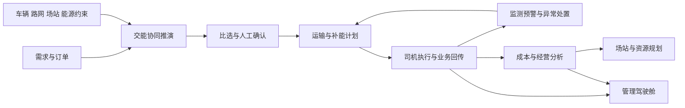

# 交能融合智能体平台产品整理

版本：V0.2 ｜ 日期：2026-10-13 ｜ 节点：D0 范围与证据修订 ｜ 状态：待确认

## 1 本次产品结论

建议定位为：以运输订单为起点，把运输组织、车辆补能、能源供给和运营分析贯通起来的交能协同运营平台，通过可解释的推演与预测辅助调度，并以实际运营数据支撑场站及车辆、电池资源规划。

建设起点仍遵循用户已确认的“从零设计新平台”，产品目标仍为“实际运营与汇报展示并重”。与上一版相比，本版以新增需规为主要业务参考，将九个模块、47个功能点完整纳入范围候选；新增内容尚不等于已经批准全部首期实施。

平台体验建议围绕三个问题展开：

1. 这批货怎么运：比较车辆投入、路径、发车时序、补能安排、时效和成本。
2. 接下来能否顺利完成：预测车辆到站、排队和负荷风险，调整计划并回传实际结果。
3. 后续资源怎么投：根据真实业务量与运行瓶颈，比较站点、设备、车辆和电池配置方案。

## 2 三类资料如何使用

| 资料 | 在本产品设计中的作用 | 证据状态与边界 |
|---|---|---|
| 项目实施方案 SRC-001 | 说明平台为什么建设、六项核心能力和产业价值 | 文档表述已核对；建设目标、投资和效益仍为规划或测算 |
| 需求规格说明 SRC-004 | 主要业务范围依据：九模块、47功能、两类角色、三条业务流程、八类数据与九项非功能要求 | 文档自称 V1.0 评审初稿；P0013 明确细分需求须评审，不能视为冻结需求 |
| 产品设计参考 SRC-005 | 辽粮页面风格及多式联运求解体验的参考方向 | 文本允许提出更好布局；参考业务与当前交能业务并不相同 |
| 辽粮网站 SRC-006 | 核对门户、业务工作台、智能体中心及方案求解页 | 首次进入超时，重试后成功；已核实初始界面与操作路径，未实际提交求解或验证算法结果 |
| 千方科技文章 SRC-008 | 补能智能体的行业场景与功能表达参考 | 2026-09-11官方发布；产品效果为厂商自述，不作为本项目效果或验收承诺 |
| 用户输入 SRC-002/003/007 | 确定建设起点、目标权重和本轮参考要求 | 已确认从零设计、运营与展示并重；未确认完整范围与阶段审批 |

资料使用原则：用户明确指令优先；需规细化业务、实施方案解释背景、设计参考提供体验方向。资料有冲突时记录差异，不用页面参考推导新增业务需求。

## 3 操作角色和使用端

依据需规 §1.4、§2.2、§11.4，当前操作角色按两类整理：

| 操作角色 | 主要职责 | 使用端建议 |
|---|---|---|
| 平台管理员 | 需求与订单、推演比选、计划确认与派单、运行监测、异常处置、场站能源、资产成本及系统管理 | 桌面管理端；支持运营工作台和汇报驾驶舱两种视角 |
| 司机 | 接收或拒绝任务、查看路线及补能安排、反馈装卸运输节点、上报异常、提交完成信息 | 移动任务端；小程序、H5 或其他形态待 QC-02 确认 |

运输企业、个体运输户、车队、场站运营方、能源方、电池银行是需要建档、协作或供数的业务主体，不自动对应独立登录角色。政府和合作方可作为汇报受众，独立访问端和数据权限仍需确认。

“平台管理员”覆盖多项业务职责，正式设计时还需确认是否所有管理员拥有同样权限，或在该角色下细分数据范围与操作授权；不能自行新增角色绕过 QC-10。

## 4 九个模块及47个功能点

模块按需规表4完整保留。产品菜单可按任务组织，不要求一章对应一个一级菜单；具体菜单在 D2 确认。

| 模块 | 功能点 | 产品应交付的业务结果 |
|---|---|---|
| M01 运输订单与交能协同调度（5） | 运输需求登记；订单管理；交能协同推演；方案比选与确认；任务派单 | 从需求形成订单，得到可比较方案，确认后生成任务 |
| M02 运输组织与执行管理（5） | 运力资源管理；运输计划与时序管理；司机任务接收；运输执行反馈；任务变更与完工确认 | 将调度计划转成司机可执行任务，形成计划与实际对照 |
| M03 充换电运营管理（6） | 充换电场站管理；补能设备状态监测；车辆补能计划管理；未来补能需求预测；补能时序优化；充换电作业记录 | 掌握当前服务能力与未来到站压力，记录实际补能结果 |
| M04 交通能源协同管理（5） | 能源资源数据管理；场站用能负荷监测；分时段负荷预测；充放电策略优化；交能协同计划管理 | 把补能需求转成能源需求，生成符合供电边界的协同计划 |
| M05 场站智能布局与资源规划（5） | 运输需求与交通流量分析；候选场站选址分析；站点等级与容量测算；车辆及电池投放测算；布局方案比选与成果管理 | 依据需求缺口形成可复核的网络布局和资源投放建议 |
| M06 运行监测与安全保障（6） | 综合运营态势；车辆实时运行监测；运输轨迹与过程回溯；场站运行状态监测；异常识别与分级预警；预警处置与应急协同 | 从态势定位风险，关联受影响业务并跟踪处置闭环 |
| M07 成本管控与综合运营管理（5） | 运输成本测算；能源费用与补能成本管理；车辆与电池资产管理；车辆置换与合作运力管理；运营分析与报表 | 看清成本形成、资源归属及投运情况，支持经营复盘 |
| M08 AI智能体辅助服务（5） | 智能业务问答；交能调度辅助智能体；补能预测解读智能体；站点规划辅助智能体；风险研判与处置建议 | 查询已有业务，调用计算能力，解释结果并提出可审查建议 |
| M09 基础数据与系统管理（5） | 业务主体与基础档案；车辆与场站数据接入；数据质量与追溯；用户角色与访问控制；日志审计与基础配置 | 统一对象、来源、权限和版本，为业务与计算提供可信底座 |

逐项来源、原文功能说明、产品承接方向和首版层次建议见 `source-feature-inventory.csv`，该表是 D0 来源盘点，不是已批准的需求清单。

## 5 三条主要业务流程

### 5.1 运输与补能协同

需求登记 → 订单形成 → 数据核验 → 交能推演 → 方案比较与管理员确认 → 生成运输及补能计划 → 派单 → 司机接收与执行 → 实际运输和补能记录回传 → 完工与成本分析。

需规明确的核心关系是“订单—推演方案—任务—车辆/司机—补能计划—实际记录”。建议让用户能沿这些关联跳转，减少跨页面重新查找。

司机拒单、车辆不可用、任务冲突、路线约束或场站能力不足，应在确认与派单前后分别处理。具体状态迁移、改派规则与失效重算条件仍需 QC-06 确认，现阶段不把示例状态冻结成系统规则。

### 5.2 运行异常处置

采集车辆/场站/能源数据或接收司机反馈 → 生成风险提示 → 管理员核实 → 关联受影响任务、车辆及补能计划 → 采取改派、调整补能、协调救援等措施 → 确认结果并归档。

告警必须能导向业务处置。例如设备故障应指出受影响的计划到站车辆，调整后应同步相关任务和补能计划。算法风险提示与已核实故障需区分。

### 5.3 场站和资源规划

归集真实运输及补能记录 → 识别交通流量与分时段需求 → 比较候选位置、既有网络、用地和接电条件 → 测算设备容量及车辆/电池配比 → 比较方案并保存版本 → 形成供人工审查的建议。

规划结果保留数据区间、计算假设、未核实条件和评价依据，不替代工程可研、土地或电网接入审批。

## 6 产品组织和页面方向

以下为 D0 产品组织建议，用于范围讨论；尚未进入正式菜单、路由或页面规格设计。

| 使用空间 | 建议呈现方式 | 对应业务能力 |
|---|---|---|
| 运营总览 | 任务、车辆、补能、能源和预警的整体状态，关联地图和异常入口 | M06 综合态势，复用其他模块数据 |
| 订单与调度 | 需求/订单列表进入交能推演，选定方案后生成计划与派单 | M01、M02 |
| 充换电与能源 | 看当前站点及设备，切换未来到站、排队和能源负荷，调整协同计划 | M03、M04 |
| 安全与处置 | 告警列表、影响对象、处置过程、轨迹和事件回放 | M06 |
| 规划与经营 | 站点与投放方案比选、成本分析、资产置换和运营报表 | M05、M07；后续可按使用频率拆分 |
| 基础管理 | 主数据、接口质量、访问范围、日志和业务参数 | M09 |
| 智能助手 | 统一入口加各业务页面的上下文入口，链接对应记录和计算结果 | M08，跨模块使用 |

管理驾驶舱是运营与经营数据的展示视角，支持按时间、区域、场站和主体筛选及下钻。汇报全屏模式为产品建议，不另建一套指标。门户宣传页不是需规必选项，如需建设应另确认。

### 交能推演应成为重点体验

建议采用“条件配置—推演结果—方案比较—确认派单”的连续工作流。桌面宽屏可将条件区、地图/时序区和方案区同时展示，也可先分步骤填写再进入宽屏结果工作台；D4 结合信息密度和可用性选择。

条件区包括订单/需求、起讫地、运量、作业时间要求、可用车辆、初始 SOC、能耗参数、场站与能源边界。缺失信息应提示对结果的影响。

结果区建议提供三种互补视图：

- 地图：运输路径、装卸点、补能站点及绕行情况。
- 时序：车辆发车、装卸、行驶、等待、补能和完工的衔接。
- 方案比较：车辆数、车次、里程、时长、能耗、补能次数、等待和综合成本，均与需规 §3.4 对应。

每次求解保留输入、数据时间、约束、版本和结果；不可行时显示冲突条件，部分输入仅为估算时标注测算属性。人工调整约束后重新推演，选定版本再确认和派单。

需规只要求“可行、可解释、可比较”的方案，未规定优化目标权重。最低成本、最快完成或较少车辆等目标及优先级须 QC-06 确认，不能在界面中预先写成既定业务规则。

### 场站页面要体现未来压力

建议在当前设备状态之外，显示计划到站、预计服务、排队和负荷的分时段变化，并关联受影响车辆及任务。预测窗口、时间粒度和模型输入按 QC-07 确认；原文三小时、六小时为场景举例，不直接固定为验收规格。

### 司机端要能完成执行反馈

司机端集中呈现待接任务、执行中任务、补能安排、异常反馈和完工信息。任务节点回传、拒单原因、改派反馈及完成资料必须与管理端关联；通知渠道和离线处理方式后续确定。

## 7 如何吸收外部产品参考

### 7.1 辽粮参考的界面与求解体验

`产品设计.txt` 提出参考辽粮页面风格及多式联运求解，同时允许更好的方式或布局。2026-10-13 实际查看公开首页、业务工作台、智能体中心和方案求解初始页。

门户按业务服务、智能服务、数据服务和物流全景组织内容；工作台提供业务快捷入口、运输概览、待办、最近运输任务及AI入口。业务页面可见浅色背景、白色内容面板、红色重点状态和清晰表单分组；智能体中心采用独立对话工作区。以上作为风格和组织参考，具体设计规范在D4确定。

方案求解初始页可核实：运输条件分为路线、货物与运输安排、方式偏好、时间和可选预算；提供重置与开始求解；另有高德路径地图、运输方式图层、适配全程和推荐方案区域。智能体中心说明先整理条件供确认，再调用求解器，并能继续到业务求解页。可参考地址：[业务工作台](https://shulian-ll.onrender.com/workbench)、[方案求解](https://shulian-ll.onrender.com/plans/solve)、[智能体中心](https://shulian-ll.onrender.com/agents?agent=PLAN)。

本次只查看初始页面，未提交运输需求或求解，未验证结果详情、地图路线精度、算法性能和发布行为。地图、时序与多方案比较结合的交能工作台仍为本项目建议；参考页的手机宽度观察不构成桌面具体分栏布局的证据。

联运方式、港航资源、粮食贸易等参考业务不纳入交能平台；本项目的求解重点是新能源重卡运输、车辆 SOC、场站服务能力、补能排队与能源约束。

### 7.2 千方补能智能体的业务借鉴

千方科技2026-09-11文章介绍补能智能体的业务问答、充电规划、异常识别和成本分析，并讨论跨站结算痛点。它以任务前规划、任务中预警、任务后复盘组织补能服务。[文章原文](https://www.ctfo.com/newsDetails?id=1987&source=2)

对本项目的产品建议如下，属于设计推导，尚需评审：

| 参考启发 | 本项目建议 | 对应需规与边界 |
|---|---|---|
| 任务前规划 | 推演结果直接说明在哪补能、何时到站、补多少，以及时效、成本和电量余量 | §3.3—3.4、§5.3—5.5；充电量与换电资源约束分别处理 |
| 任务中预警 | 在当前安全告警之外，评估高成本补能行为是否值得提示，并关联可执行的调整建议 | §8.5、§10.5；费用偏高不直接认定违规，规则与例外待确认 |
| 任务后复盘 | 将预计与实际能耗、补能费、等待时长按车辆、线路和任务比较，记录建议是否被采纳及后续效果 | §9.1—9.2、§9.5；定时报表推送渠道与频率属新增待确认项 |
| 统一问答入口 | 让管理员查原因、比较方案，让司机在自身任务内查询补能安排 | §10.1—10.5；司机AI入口是扩展建议，需规目前AI服务主要面向管理员 |
| 成本与服务条件联合分析 | 将已取得的电价、服务费、排队和适配信息放在方案比较中；地形、温度等修正需有可信数据及模型 | §3.3—3.4、§9.2；不将尚未验证因素直接写成可用计算能力 |

建议用“任务前怎么安排—途中是否需调整—完成后怎样改进”组织智能辅助场景。这与既有九模块形成映射，无需额外堆叠同名功能入口。

跨场站充值、统一支付结算和开票涉及商业合作与资金流程，超出当前需规的成本记录与分析范围，登记为扩展候选，不默认加入首版。文章中的多角色配置也不改变本项目两类操作角色。厂商所述接入规模、模型效果与降本成果不能移用为本项目实绩。

## 8 首版范围分层建议

九模块、47功能是产品范围候选，实施顺序由数据与场景决定。以下是排期建议，不删除需规条目，也不替代范围审批。

| 层次 | 建议覆盖 | 目标与条件 |
|---|---|---|
| A 首版运营闭环 | 需求订单、运力台账、基础交能推演与方案比较、确认派单、司机反馈、补能计划及记录、基本监测与异常、成本记录、主数据权限日志 | 能完成真实试点任务，并追溯计划和实际；计算范围由已确认输入和约束决定 |
| B 首版重点展示及辅助决策 | 管理驾驶舱、未来到站和排队预测、分时负荷预测、能源策略比较、场站规划比选、智能查询与结果解读 | 体现交能特色；数据和模型不足时用明确标注的条件测算或样例演示，不能算作实运营能力验收 |
| C 随业务与数据深化 | 更大规模联合优化、精细化资产置换和成本分摊、车辆电池投放分析、规划网络优化 | 随数据积累和业务确认细化；保留完整需求追踪 |

同一功能可能跨层递进。例如场站负荷首先需有可信接入和记录，才可能验收预测偏差；智能体先能检索与解释业务数据，再逐步调用更成熟的推演能力。

## 9 AI与计算能力的关系

按需规 §10，将五类 AI 能力保留为服务能力：业务问答、调度辅助、补能预测解读、站点规划辅助、风险研判。是否拆成多个独立智能体不在本次预设。

交能推演、排队与负荷预测、成本计算及选址测算负责结构化计算；AI 理解用户任务、调用授权能力、解释结果和提出建议。需要明确输入、输出和计算依据，不能用语言模型直接编造路线、SOC、排队时间、负荷或成本。

建议统一记录关联业务对象、输入时间与来源、参数和规则版本、计算或回答结果、人工确认和后续执行。需规明确调度结果须管理员确认，设备控制不默认开放。

## 10 数据和非功能要求

需规 §2.4 表3覆盖八类数据：运输业务、车辆运力、交通路网、场站设备、补能业务、能源资源、价格成本、规划资产。后续按具体数据对象、来源与用途核实覆盖。

每项关键数据保留对象标识、来源和采集时间，并区分真实采集、人工登记、推算预测与演示模拟。未接入、离线、延迟和缺失单独表达，不用零值代替。预测与实际使用一致统计窗口才能比较偏差。

需规 §12 的九项非功能要求全部保留：可靠性、安全性、数据真实性与可追溯性、性能与时效、可扩展性、易用性、接口兼容性、可维护性、智能体可信与安全。响应秒数、刷新频率、预测精度、试点规模和恢复指标尚未量化，应在数据及规模确认后确定，不能作为本轮已定承诺。

## 11 资料差异及待决事项

| 编号 | 问题或差异 | 本版处理 |
|---|---|---|
| DIFF-01 | 上版候选用户较多，需规拟定只有两类操作角色 | 按管理员、司机组织操作端；其他主体独立账号列 QC-10 |
| DIFF-02 | 原方案与需规提到适配迁移，用户确认从零设计 | 新建优先；QC-11 仅保留可选数据导入/复用盘点，不把旧系统当必备依赖 |
| DIFF-03 | 需规为评审初稿，细分功能不全是实施方案逐字要求 | 47项作为范围候选，不自动标为已批准需求 |
| DIFF-04 | 上版首版偏重基础运营，需规对预测和方案比选更明确 | 补强推演、预测、能源和规划的产品表达，分层安排实施深度 |
| DIFF-05 | 辽粮入口首次超时，重试后可访问 | 已核实工作台、智能体中心与求解初始页；结果详情与算法能力未验证 |
| DIFF-06 | “交能一体化”文件名与“交能融合”正文标题不同 | 产品暂沿用正文及背景的“交能融合智能体平台”，正式品牌待定 |
| DIFF-07 | 千方文章包括多角色、统一充值结算及推送报表 | 作为行业启发；独立账号、资金结算、司机AI与定时推送均不自动变成已批准需求 |

需规 QC-01—QC-12 全部保留：订单来源、司机端形态、车辆接口、场站接口、能源数据与控制边界、推演目标与派单规则、预测粒度与窗口、成本口径、规划数据及审查主体、额外角色、旧系统复用范围、一期规模与量化验收。当前没有相应材料证明这些问题已解决。

后续最先需要明确的三组输入：

1. 试点业务：哪些矿区/厂区、线路、订单和车辆，以及订单、任务、车次之间的组织方式。
2. 接入资源：车辆 GPS/SOC、场站工位和补能记录、负荷及电价哪些可以获得，更新频率如何。
3. 决策规则：优先优化成本、时效还是车辆投入，人工确认与改派边界，首版司机端形态。

## 12 当前节点与后续交付

本轮完成 D0 产品范围修订、来源登记、47项来源功能盘点及参考核验记录。保留 V0.1 供对照，尚未批准 D0、冻结设计或进入开发。

建议用户确认的具体内容是：以九模块47功能作为整体产品范围候选，按管理员与司机两类操作角色设计，重点突出交能推演、未来补能与负荷预测、执行反馈，以及可追溯的管理驾驶舱；首版深度按第8节继续讨论。

确认 D0 后进入 D1，形成带来源、优先级、角色和验收目标的需求清单；随后 D2 确认业务流程与菜单，再进入模块 PRD、页面交互和原型。
