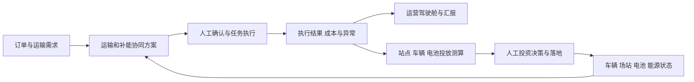

# 交能融合智能体平台产品梳理

版本：V0.1 ｜ 日期：2026-10-13 ｜ 当前节点：D0 项目启动与证据建档 ｜ 状态：待用户确认

## 1 产品定位与本次结论

建议将产品定位为：面向交能融合项目运营主体，贯通运输订单、车辆、充换电场站、电池和能源数据，通过智能辅助决策协调运输与补能，并以真实运营结果支撑资产投放的综合运营平台。

用户已明确：从零设计新平台；实际运营与项目汇报展示两者并重。因此建议形成“业务运营工作台 + 管理驾驶舱”两种使用视角，使用统一的业务对象、指标口径和数据来源。演示阶段可使用明确标注的样例数据；真实运营阶段展示实际接入结果。

平台的两条价值主线：

- 日常运营：把订单、车辆、路径、补能资源和能源供给协调起来，完成任务并复盘成本。
- 投资决策：用实际订单、交通流量、车辆利用率、补能需求和负荷曲线，辅助决定在哪里建站、投多少车、配多少电池。

以上是对原文的产品化解释，不代表已完成需求审批或技术可行性验证。

## 2 项目启动基准

| 项目属性 | 内容 |
|---|---|
| 产品名称 | 交能融合智能体平台；正式品牌名待定 |
| 设计版本与交付日期 | 当前 V0.1；设计和首版交付日期待确认，不能直接沿用产业方案工期 |
| 项目地域与切入场景 | 庆阳市；原文优先发展核心煤炭矿区短倒运输 |
| 建设与运营主体 | 原文由华系投资牵头、SPV 承载、数字平台公司负责平台与数据资产；实际签约主体、产品负责人待确认 |
| 建设起点 | 用户确认从零设计新平台；不以取得大同平台源码或迁移既有系统为前提 |
| 产品目标 | 用户确认实际运营与汇报展示并重 |
| 本次设计范围 | 产品定位、候选角色、业务能力边界、首版范围建议、证据和待决事项 |
| 视觉要求 | 本次不确定视觉风格；运营工作台强调任务可操作，驾驶舱强调数据可解释、可下钻，D4 再确定视觉规范 |
| 技术约束 | 项目开发阶段要求 Node.js 与 SQLite；当前仅设计，不作性能或设备接入能力承诺 |
| 部署边界 | 原文提到云端先行、未来园区中控承载；当前项目不配置部署交付阶段 |
| 参考资料 | SRC-001 实施方案，重点第三章；本次用户说明 SRC-002、SRC-003 |

## 3 证据口径与原文要求

“文档明确”表示实施方案中有此表述，不表示实际建设、接入或商业效果已得到验证。“用户确认”表示本轮明确指令。“建议”表示本次推导，仍需确认。

| 编号 | 原文要求 | 产品含义 | 来源与证据状态 |
|---|---|---|---|
| CAP-01 | 双侧精准调度 | 同时考虑运输需求与能源供给，输出可执行的运输和补能协同方案 | 第三章（二）1，P080；文档明确 |
| CAP-02 | 场站智能布局 | 比较候选站点的服务需求、位置、等级与容量，形成规划建议 | 第三章（二）2，P081；文档明确 |
| CAP-03 | 运营时序优化 | 联合安排车辆路径、充换电顺序和时间，减少排队和等待 | 第三章（二）3，P082；文档明确 |
| CAP-04 | 充放电定制化 | 结合交通需求、电价与能源条件制定充放电计划 | 第三章（二）4，P083；文档明确；控制对象待核实 |
| CAP-05 | 成本智能管控 | 关联购车、租赁、用电、维保、运输成本，比较方案和实际结果 | 第三章（二）5，P084；文档明确 |
| CAP-06 | 综合运营管理 | 车辆置换、任务派发、安全监控、故障预警救援、个体运输户与企业挂靠合作 | 第三章（二）6，P085；文档明确 |

支撑要求：车辆、场站、电网和订单数据接入见 P072、P088；电池配比、绿电规模与资产决策见 P074、P090；电池全生命周期溯源见表7；组织关系见 P098。

原文没有给出字段、角色权限、调度规则、接口清单、算法指标或智能体执行授权，这些都需要后续发现和设计。

## 4 谁使用平台

以下是根据业务职责推导的候选用户，尚不是已批准的权限角色。

| 候选用户 | 核心任务 | 推荐使用视角 |
|---|---|---|
| SPV 管理层、项目负责人 | 看经营、查异常、看项目进展、比较投资方案 | 管理驾驶舱与经营分析 |
| 运力运营人员、调度员 | 归集订单、匹配车辆、安排运输与补能、处理异常 | 业务运营工作台 |
| 车队企业、个体运输户、司机 | 维护运力信息、确认任务、反馈执行结果和补能需求 | 协作入口；独立移动端是否首期建设待定 |
| 场站运营人员 | 查看站点容量、排队、设备可用性与补能安排 | 场站运营工作台 |
| 能源运营人员 | 查看负荷、电价、能源供给和充放电计划 | 能源协同工作台 |
| 电池资产运营人员 | 查询电池归属、流转、可用数量和健康信息 | 电池资产管理 |
| 成本与经营分析人员 | 归集成本、比较运输任务和车队经营结果 | 成本与经营分析 |
| 政府及合作方汇报受众 | 了解示范项目建设与运营成果 | 授权汇报视图；不默认开放独立账号 |
| 平台管理与数据维护人员 | 组织与用户维护、数据接入、质量核验、操作留痕 | 平台基础能力 |

需优先访谈调度员、站长及能源运营人员，确认实际工作方式；再由项目负责人确认范围，由设备及系统数据负责人确认接入条件。

## 5 从业务理解产品能力

本节是 D0 范围候选，不是已批准菜单或详细 PRD。

| 业务能力 | 主要处理什么 | 输出什么 | 来源与推导 |
|---|---|---|---|
| 运营总览与汇报 | 车辆、订单、场站、能源、成本、告警和建设目标 | 经营总览、异常入口、规划与实际对比、汇报视图 | 综合运营和数据驱动的产品化建议 |
| 运输与运力运营 | 订单、任务、企业与个体户、车辆、司机、合作关系 | 派车方案、执行记录、异常处置、任务结果 | CAP-01/03/06；司机任务反馈为闭环建议 |
| 充换电与能源协同 | 场站、设备、补能需求、排队、供电负荷、电价 | 补能计划、充放电计划、资源约束与执行差异 | CAP-01/03/04 |
| 电池与车辆资产 | 车辆置换、租赁关联、电池归属与流转 | 资产台账、供需与配比分析、生命周期记录 | CAP-06、P090、P110、表7 |
| 安全与运维 | 车辆和设备告警、故障、救援 | 告警处置记录、恢复状态、责任与处理时长 | CAP-06；处置闭环为建议 |
| 成本与经营分析 | 购车、租赁、能源、维保、运输等成本 | 单车、任务、线路、场站等口径的成本分析 | CAP-05；核算维度为建议 |
| 场站规划与投资辅助 | 候选站点、交通与订单需求、容量及投资假设 | 站点比较、车辆投放、电池配比与绿电规模建议 | CAP-02、P074、P090 |
| 数据与智能体基础能力 | 组织、主数据、接入状态、规则、智能任务记录 | 一致的数据口径、可追溯的建议和执行记录 | 支撑上述业务的产品化建议 |

智能体能力应嵌入这些业务任务，统一入口可帮助用户发起任务，但每项建议仍需能关联订单、车辆、场站和执行结果。

## 6 两条核心业务链

### 6.1 日常运输与补能协同

建议闭环：归集运输需求 → 确认可用运力与能源资源 → 生成运输及补能候选方案 → 调度人员确认 → 派发与执行反馈 → 异常调整 → 完成记录与成本复盘。

例如，面对一批矿区短倒任务，平台需要回答：哪些车能按时完成、途中是否需要补能、哪些站点与电池适配、预计等待多久、选择不同方案的成本有什么变化。该例仅用于说明任务，不代表已经取得真实订单或车辆数据。

若执行期间场站故障、车辆电量不足或任务延期，应关联原任务提出调整建议。原文提出监控、预警和救援，具体触发条件、责任人和时限需在 D1—D3 定义。

### 6.2 运营数据支持资产投放

建议闭环：沉淀实际订单与运行数据 → 识别运力、补能和供电缺口 → 比较候选方案 → 人工评审投资建议 → 记录获批投放及实际落地 → 用运营结果复盘假设。

规划方案必须保留输入时间区间、数据覆盖范围、测算假设和约束；数据不足时显示条件测算。投资审批和资金拨付系统不自动纳入首版。

## 7 智能体应承担的工作

以下为能力分工建议，并不要求独立实现多个智能体，也不预设具体模型或框架。

| 智能任务 | 输入依赖 | 可交付结果 | 首版边界建议 |
|---|---|---|---|
| 运输与补能协同 | 订单、车辆位置与电量、运力规则、场站容量及适配信息 | 可比较的派车、路径和补能方案，约束及推荐理由 | 优先建设，人工确认后进入业务执行 |
| 充放电计划 | 电价、负荷、可用电池/储能、供电限制、预计补能需求 | 分时计划、预计成本、供需缺口 | 先辅助制定计划；设备控制接入另行确认 |
| 成本分析 | 实际业务记录、费用来源、核算口径 | 成本差异、异常原因候选及改进建议 | 优先做可追溯分析，不把推测原因当事实 |
| 场站布局与资产投放 | 历史交通与订单、候选点、用地和接电条件、投资假设 | 候选方案比较与敏感性分析 | 首版可做有依据的方案测算，数据积累后再深化 |

智能建议应展示数据来源和时效、适用对象、约束、预期效果及人工处理记录。缺失关键输入时提示缺项，不宣称已经得到最优结果；人工可修改或拒绝建议。涉及派单、改派和设备动作的授权边界在后续阶段明确。

建议评价智能能力时使用业务可行性、建议采纳情况、执行偏差和实际效果；不以问答条数作为主要成效。具体阈值需取得基线后确定。

## 8 首版范围建议

### 首版同时交付运营与展示价值

建议以“一条典型运输业务链 + 一组试点场站”的可操作闭环作为范围切口，实际数量由用户和接入条件确定。

| 范围 | 首版建议 | 交付价值 |
|---|---|---|
| 业务基础 | 企业/个体户、车辆、司机、场站、电池基础台账，数据来源与更新时间 | 能识别资源、责任和可用性 |
| 运输执行 | 订单归集、任务派发、执行反馈与异常记录 | 有可实际使用的运营流程 |
| 补能协同 | 车辆与场站状态、补能需求、人工可确认的协同计划 | 体现交通与能源协同价值 |
| 安全保障 | 已具备数据来源的关键告警与处置记录 | 支撑运营异常恢复 |
| 经营分析 | 运输与用能记录、基础成本归集、计划与实际比较 | 看得到运营结果；缺失成本项明确显示 |
| 管理驾驶舱 | 资源分布、运营状态、告警、能耗成本、规划目标与实际进展 | 同时满足管理和项目汇报，下钻至业务记录 |
| 规划示范 | 一个有数据依据的候选站点/容量对比场景 | 体现投资辅助能力；无实测数据时标注条件测算 |
| 智能入口 | 重点支持运输补能方案和经营查询，显示建议依据 | 将智能能力与业务动作衔接 |

首版范围中的状态监控与自动采集，取决于实际接口。可在设计中保留人工录入/导入路径，但必须显示来源和时间，不能显示为实时遥测。

### 后续逐步扩展

- 随运营数据积累，深化全域联合调度、充放电优化、场站布局和资产投放测算。
- 随资产业务落地，深化车电分离、车辆置换、租赁关联、电池生命周期与配比分析。
- 随产业服务成熟，再论证碳服务、数据资产服务、园区与回收业务的系统范围。

上述软件版本安排是建议，不等同于原文 2027—2028 年产业建设分期。

## 9 数据前提与真实性

| 数据领域 | 需要核实的数据 | 当前状态 |
|---|---|---|
| 运输 | 真实订单、线路、装卸点、任务时间要求、运力合作关系 | 方案描述，未提供样本或接口 |
| 车辆 | 档案、位置、电量、状态、车型与电池适配、实际执行反馈 | 未验证接入能力 |
| 场站 | 站点位置、设备类型与容量、可用状态、排队、库存及适配 | 未提供首批清单 |
| 能源 | 分时电价、实际负荷、绿电供给、接电限制、储能和电池约束 | 数据主体和访问权限待核实 |
| 成本 | 费用记录、计价规则、租赁约定、维保支出、分摊依据 | 未提供；首版核算口径待确认 |
| 规划 | 交通流量、矿区路网、候选用地、接电条件、投资假设 | 方案要求，未提供基础数据 |

规划、估算、样例与实际必须区分；页面指标需要显示时间范围和口径。无接口不等于零值，无记录不等于无异常。驾驶舱展示的数值应能追溯至底层记录，避免与运营工作台各自计算。

## 10 明确排除与待核实事项

当前不将以下事项默认列入首版：产业园招商与生产制造系统、完整融资审批与银行放款、完整财务税务系统、碳交易与数据资产交易、设备无人值守自主控制、面向全国的运力交易市场。原文涉及相关产业或价值方向，但不足以确认这些软件需求。

本轮不修改正式源码、数据库、接口或部署配置，不建设原型，不宣布设计冻结。

| 编号 | 待决事项 | 当前处理方式 |
|---|---|---|
| DEC-01 | 实际运营与汇报展示的关系 | 用户已确认两者并重；建议共用业务数据、提供两种视角 |
| DEC-02 | 新建还是迁移 | 用户已确认从零设计；原文 P075/P087 的复制迁移仅保留为背景 |
| DEC-03 | 首个运营场景和用户组织 | 建议以核心煤炭矿区短倒为切口，待确认具体企业、线路、人员与场站 |
| DEC-04 | 平台首版业务边界 | 第8节为建议，待确认；尚未承诺开发工作量与日期 |
| DEC-05 | 数据接入和设备执行能力 | 尚未取得样本、协议或授权，后续访谈数据负责人 |
| DEC-06 | 充放电对象 | 需区分储能、电池库和车辆电池，不能直接推导车辆向电网放电能力 |
| DEC-07 | 智能体执行程度 | 首版建议人工确认后执行，是否允许任何自动动作待明确 |
| DEC-08 | 目标及工期口径 | 原文有0—3个月适配、4—6个月接入上线、90天具备上线条件等表述；新建平台排期需重新确认 |
| DEC-09 | 负荷口径 | 原文“单站32兆瓦”适用母站、子站或特定站型不明确，不直接套用全部站点 |
| DEC-10 | 项目效益与平台效益 | 原文投资、收入、利润、减排均为产业项目规划/测算，不当作本软件预算、平台收入或已实现效果 |

## 11 目标指标与判定方式

本阶段只确定评价方向，不虚构效果基线与承诺提升比例。

| 目标 | 建议判定方法 | 目前缺项 |
|---|---|---|
| 业务可运营 | 真实试点任务可追溯需求、派发、执行、补能、异常和完成结果 | 试点范围与现状工作流程 |
| 汇报可信 | 总览可下钻，实际与规划分开，样例明确标注 | 展示受众与指标口径 |
| 调度有效 | 对比任务按时完成、车辆利用、补能等待及异常恢复情况 | 统计窗口、基线和验收阈值 |
| 成本可解释 | 能将费用关联任务/车辆/场站，并列出缺失项 | 财务来源与分摊规则 |
| 建设有依据 | 规划方案可追溯数据和假设，可比较替代方案 | 流量数据、候选点与可研约束 |

## 12 用户已确认事项与下一步

2026-10-13，用户要求主要参考实施方案中的“交能融合智能体平台”梳理产品；随后明确答复“ 两者并重 ”及“ 从零设计新平台 ”。仅这些方向已确认，不将其视为对本任务书全部内容或 D0 节点的批准。

D0 确认后，进入 D1：细化各类用户任务、真实业务场景、首版需求清单和验收目标；D2 再确认流程与菜单，随后编写详细 PRD、页面规范与独立原型。

本轮待确认：是否认可本文的产品定位、两条业务主线及首版范围建议。仍缺数据的事项保留问题编号，不用假设掩盖。
