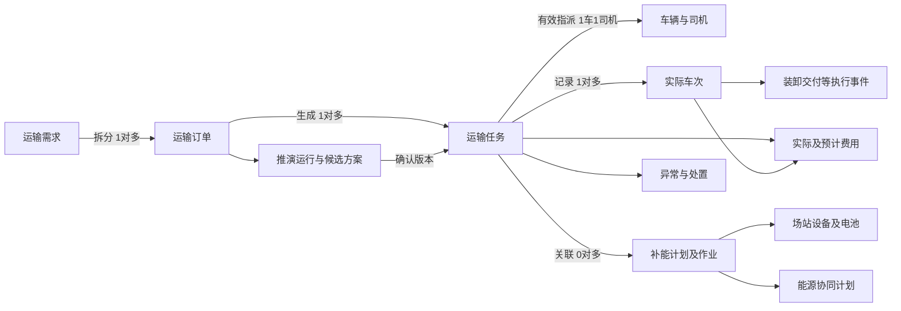

# D2 信息架构与导航设计

版本：V0.1 ｜ 日期：2026-10-13 ｜ 状态：待用户批准 ｜ 上游：D0、D1已批准

## 1 组织原则与使用角色

管理员主要围绕组织运输、协调补能能源、处置运行风险、分析经营与配置资源开展工作。主导航按这些任务组织，九个需求模块保留为业务文档和能力编号，不要求一章对应一个一级菜单。司机使用手机H5，仅处理自身任务、补能和异常。

七个管理员一级导航：运营总览、运输调度、充换电运营、能源协同、规划与经营、安全保障、基础管理。每个一级下的二级功能为独立路由；详情、编辑、确认和步骤在业务页面内下钻，不能作为二级菜单。智能助手与个人信息为通用入口，不增加同名业务数据副本。

本文件是结构与关系设计，D4再确定导航样式、组件和页面规格。所有菜单及页面仍待D2整体批准，不称已冻结。

## 2 管理端菜单树

```text
运营总览
  运营工作台          PAGE-001
  管理驾驶舱          PAGE-002
运输调度
  运输需求            PAGE-003
  运输订单            PAGE-004
  交能推演            PAGE-005
  方案记录            PAGE-006
  任务调度            PAGE-007
  运输计划            PAGE-008
  运力资源            PAGE-009
充换电运营
  场站管理            PAGE-010
  设备监测            PAGE-011
  补能计划            PAGE-012
  需求预测            PAGE-013
  时序优化            PAGE-014
  作业记录            PAGE-015
能源协同
  能源资源            PAGE-016
  负荷监测            PAGE-017
  负荷预测            PAGE-018
  策略优化            PAGE-019
  协同计划            PAGE-020
规划与经营
  [资源规划分组标签，不是可点击菜单]
  交通需求分析        PAGE-021
  场站选址            PAGE-022
  容量测算            PAGE-023
  投放测算            PAGE-024
  规划方案            PAGE-025
  [成本资产分组标签，不是可点击菜单]
  运输成本            PAGE-026
  补能费用            PAGE-027
  资产管理            PAGE-028
  置换与合作          PAGE-029
  经营报表            PAGE-030
安全保障
  车辆监测            PAGE-031
  轨迹回溯            PAGE-032
  场站运行            PAGE-033
  告警处置            PAGE-034
基础管理
  业务档案            PAGE-035
  数据接入            PAGE-036
  数据质量            PAGE-037
  用户与权限          PAGE-038
  操作日志            PAGE-039
  业务参数            PAGE-040
通用入口（不占主导航业务域）
  智能助手            PAGE-043
  个人信息            PAGE-042
  管理端登录          PAGE-041
```

“规划与经营”下两组标签用于可见分组，二级入口全部独立可定位，不以Tab隐藏模块。若后续用户审阅认为该组过长，可在D2修订时拆成两个一级域，不能在D4擅自改变已批准导航。

## 3 司机H5结构

底部四入口：我的任务（PAGE-044）、补能安排（PAGE-045）、我的异常（PAGE-047）、我的（PAGE-046）。司机登录为PAGE-048；任务、异常和补能详情分别为PAGE-049、050、051，不占底部菜单。

任务详情集中展示当前有效任务版本、计划时间、装卸位置、路线与补能安排，并提供接收/拒绝、执行节点、车次记录、异常上报和完工提交。H5只提供必要反馈，不提供管理员方案确认、改派、告警关闭或费用修改。

司机上报的到站与补能事件标明人工反馈来源，不等同场站设备计量或已结算费用。司机提交完成与管理员核验完工有明确状态差别。

## 4 各空间的边界

| 容易重叠的功能 | 主维护或操作入口 | 其他入口承担什么 |
|---|---|---|
| 运力与资产 | 运力资源维护可用时段和派车资料；资产管理维护持有租赁维保及电池流转 | 共用车辆主标识，相关字段各有维护职责，不重复建车 |
| 场站档案、设备监测、场站运行 | 场站管理维护档案；设备监测看设备粒度；安全保障场站运行看跨站态势及受影响业务 | 从站级风险跳设备及补能计划，不另建场站记录 |
| 方案记录与交能推演 | 推演页编辑条件及求解；方案记录检索历史和进入方案详情 | 从历史版本发起新推演，不覆盖历史 |
| 运输计划与任务调度 | 计划页看批次、车辆和时序协调；任务调度负责派发、改派、结果核验 | 同一任务标识与版本，共享当前有效计划 |
| 补能计划与协同计划 | 补能计划管理车辆到站服务；协同计划整合能源供需边界 | 互相关联版本，不将能源建议当场站已接受预约 |
| 总览、驾驶舱与经营报表 | 总览提供当前工作与异常入口；驾驶舱提供汇报态势；报表提供按口径分析 | 共用记录及统计口径，各自下钻，不复制算账 |
| 告警与司机异常 | 告警处置是管理员闭环；司机异常是本人反馈和处置进展视图 | 关联同一事件与任务，不生成互不相认的两套工单 |
| 智能助手与业务工作区 | AI整理条件、调用与解释；业务工作区执行授权确认动作 | 跨页带业务对象和计算版本，AI对话不独立改变执行状态 |

## 5 实体关系与任务组织

用户本轮明确采用：需求可拆多个订单，订单下多个任务，每任务对应一辆车一名司机，可记录多趟车次。



关系细化建议，等待D2整体批准：每个任务仅隶属一个订单；执行车次隶属一个任务；推演可有多个候选方案，生成任务时引用明确的运行和方案版本。补能作业可以没有运输任务关联，例如独立补能；有任务关联时应校验车辆与时段。

需求、订单、任务、车次的完成量分别定义，不能将任务数当车次数，也不能把累计完成量重复分摊到每层。D3需明确计划量、实际交付量、单位与允许偏差；目前不假设按称重、签收或GPS任一来源自动结算。

任务改派体现有效指派版本；执行期间原车已完成车次与费用不得换成新车名下。执行中需要更换车辆/司机时，建议先核验已完成量、结束原任务剩余执行责任，再为剩余量生成关联替代任务；不把原任务的历史重写为新司机执行。换班是否也采用此规则需在D3明确。

## 6 页面和URL规则

完整页面索引见page-index.md与route-index.csv，共61个目的地：40个管理业务入口、3个管理通用入口、8个司机页、10个管理详情页。页面编号供D3需求追踪和D4逐页规格复用，不代表61份PRD，也不预设61个独立HTML文件。

- 路由使用小写英文业务路径，不含身份密钥或执行命令；索引中的`:id`代表业务记录标识。
- 一级域为导航分组，可跳转到该域第一个已授权二级入口；空授权域隐藏。
- 列表查询使用对象编号、状态、时间、主体及适用业务筛选；分页、排序、筛选在返回列表时保留。D4再确定具体控件。
- 新增/编辑优先使用所属页面表单或抽屉，长流程使用独立工作区；详情页有明确主入口和返回目标。
- 业务深链接进入时重新核验角色、主体和操作权限，不能凭菜单是否可见判断访问许可。
- 非法或失效记录显示找不到/无权访问等合适反馈，不能回退显示其他主体记录。
- D5原型锚点规划为`index.html#page-001`等，不连接真实服务；目前不创建原型文件。

## 7 跨页交接与返回

| 起点 → 终点 | 传递的业务上下文 | 返回规则 |
|---|---|---|
| 需求详情 → 订单 | 需求标识、版本、可拆分数量及业务主体 | 回需求保留关联订单，不重建需求 |
| 订单 → 推演 | 订单标识和版本、装卸点、运量和时效 | 返回订单保留求解记录；修改条件不覆盖原订单 |
| 推演 → 任务调度 | 确认的运行/方案版本及运输补能候选安排 | 不带聊天文本充当可执行计划；派发前再核验 |
| 任务 → 司机H5 | 有效指派版本和必要运输补能字段 | 用户只能访问本人任务；旧指派保留只读历史或无权说明 |
| 场站风险 → 告警/补能优化 | 站点、设备、故障时间、受影响计划与车辆 | 调整后回原风险上下文，保留处置记录 |
| 补能预测 → 能源预测 | 预测运行、车辆到站及补能需求、时段与来源 | 不将未来车辆数直接当即时功率；引用计算版本 |
| AI → 推演/规划 | 已核对输入、业务对象与计算结果版本 | 回对话可引用结果；确认仍在授权业务流程中 |
| 驾驶舱 → 业务列表/详情 | 统计窗口、主体、状态及数据属性 | 返回同一统计范围，避免数字变化无解释 |

跨页上下文只引用获授权数据，长文本和来源提示属于展示，不将URL查询参数作为实际授权或审批凭据。

## 8 权限与可见性

管理员按用户本轮确认的“可管理主体范围＋可执行操作”控制；司机仅本人关联任务。只有两类角色，不为数据范围另造车队、站长或能源角色。

管理员菜单按相应查看权限与范围显示，新增、修改、推演、确认派发、改派、完工核验、费用维护、参数和授权管理分别判断。权限不足时隐藏或禁用相关操作并说明原因；已发出的请求仍需验证权限。

角色与操作矩阵见permissions.csv，具体状态流转与授权见state-permission.csv。主体范围规则须按业务对象区分：能看公共可用场站不代表能看其全部能源和经营数据；得到某任务的协作许可不代表能读取整个车队资料。

## 9 分类、标签与全局能力

统一分类包括业务主体、矿区厂区、线路、车辆/场站/设备类别、补能方式、对象状态、时间、告警等级和数据属性。状态字典来自本节点状态定义，D3进一步定义字段及取值，不在各页面自行命名相同状态。

主数据维护归业务档案或各自业务主入口；全局数据属性统一为真实采集、人工登记、算法推算、演示模拟，并结合更新时间和有效性。列表主要显示当前状态，详情保留历史。

全局组件限于已有需求：当前身份及主体范围、个人信息、智能助手入口、操作反馈和来源/更新时间。检索先采用各业务页搜索；没有依据不新增跨库全局搜索或复杂消息中心。

同一对象详情内的基本信息、车次、补能、事件和费用可用页内Tab，但不同业务模块不可借Tab代替二级菜单。

## 10 结构可发现性自检与剩余验证

管理员能从运输调度直接找到需求、推演和任务；司机能从任务直接进入接收、异常和完工；风险从安全保障定位，经营及规划从对应二级入口进入。方案、任务、告警等详情不占导航项。

已进行来源和流程桌面核对，尚未进行实际用户卡片分类、树测试或首次点击测试。D5原型可用于检验标签和入口；发现结构问题需回D2登记修订，不能在原型中静默改变已批准菜单。

## 11 本节点待批准事项

七个主导航与独立二级入口、九模块及61页结构映射、三条已确认业务规则的落实，以及processes.md、state-permission.csv和permissions.csv提出的流程/状态/权限细化。

用户本轮选择只确认对应规则，不等于已经批准本文件全部菜单与状态。D2批准后进入D3，按九模块编写详细PRD、跨模块契约与全量追踪。
