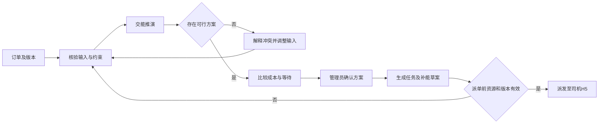

# D2 业务流程与分支

版本：V0.1 ｜ 状态：待用户批准 ｜ 流程与状态为设计细化，数值参数在D3确认

菜单修订说明：本文件原PAGE编号继续作为功能定位引用，不要求各自独立成页。当前入口按menu-tree-v0.2.md，旧功能归属按function-locations.csv，需求主入口按requirement-route-map.csv。

## FLOW-001 基础资料、接入与授权准备

- 触发主体：获授权管理员；外部系统仅是数据来源，不新增操作角色。
- 输入：主体、矿区厂区线路、车辆司机、场站设备、能源、账号操作范围、数据源与参数资料。
- 顺序：管理员建立或核对唯一业务标识 → 配置对应范围内的主档和数据映射 → 采集/录入并检查质量 → 标记更新时间及有效性 → 将可用资源供订单与测算引用。
- 传递：资源可用状态、车型与补能适配、数据属性、当前参数及映射版本进入FLOW-003/006/007；授权限制贯穿所有流程。
- 出口：可引用的已核验资料，或可解释的未接入/缺失/异常状态。
- 分支：重复对象提示核对，来源中断保留最后有效时间，人工纠正不覆盖来源历史；失败可重试，不用模拟补齐实绩。已有记录允许查询的部分不因单源故障全部不可用。
- 审计：维护主体与操作者、参数和数据来源版本。权限授予范围不能超出已授权可授予边界，细则在D3定义。
- 需求：REQ-006、011、017、043—055；页面：009—011、016、035—042；对象：OBJ-011/012/013/016。

## FLOW-002 需求拆单与订单组织

- 主体与触发：管理员收到运输委托；输入需求主体、货物运量、起讫点和作业时间要求。
- 顺序：登记需求草稿 → 核对并确认可拆分要求 → 生成一个或多个订单 → 核对各订单计划量和时间 → 从订单发起推演。
- 关联：需求1:N订单；订单拥有独立编号和版本。需求量、已分配量、剩余待分配量分别表达，部分拆单后仍可分配剩余需求，不把剩余量清零。
- 正常出口：订单待推演，需求保持未分配/部分分配/已分配的派生分配标记。
- 变更：已生成订单的需求不能直接删除来消除关联；订单修改提示受影响方案和任务，保留原版本。草稿的软删除或取消界限在D3定义。
- 取消：未执行部分可申请取消；已执行记录保留。订单未履约量、取消量与已完成量分开，不因取消而增加完成量。
- 校验：计划分配量不能重复计入需求剩余量；数量单位与允许超差在D3明确。
- 需求：REQ-001/002；页面：003/004/052/053；对象：OBJ-001/002。

## FLOW-003 交能推演、确认与派单

- 主体：管理员；可由AI整理输入，但确认操作仍归管理员。
- 输入：订单版本、需求量与时效、车辆司机可用时段、SOC与能耗、路网和场站适配、服务与供电边界及参数版本。
- 顺序：核验关键输入及来源 → 执行推演 → 查看可行或不可行结果 → 先满足时效、电量安全和资源可用性，再比较成本与等待 → 选定候选方案并确认 → 生成任务与关联补能草案 → 校验有效指派及资源冲突 → 派发到司机H5。
- 关联：订单1:N推演运行；一次运行可产生多个候选方案。任务引用具体确认版本，每任务一个当前有效车辆和司机，可安排多车次；时序计划关联任务、批次与补能计划。
- 派单校验：授权范围、订单与方案版本、车辆司机可用性、适配及时间冲突；任何条件已变化时应提示核验/重算，不自动采纳旧方案。
- 无解/失败：无解解释冲突，计算失败保留输入并支持重试；两者不能都显示“无推荐方案”。不得静默放松硬约束。
- 原子业务结果建议：一轮派单若只成功部分任务，要明确成功和失败范围及剩余任务；重试不能让同一版本重复派发。是否采用全部成功或逐任务确认在D3明确。
- 出口：任务待接单、对应有效补能安排；派单不等于场站系统已预约成功，不产生设备控制。
- 需求：REQ-003—005、007、013、021、039；页面：005—008/012/020/043/054/055/061；对象：OBJ-003/004/005/007/008。

## FLOW-004 司机承接、多车次执行与核验完工

- 主体：司机与管理员；输入待接单任务、指派版本、运输及补能安排。
- 顺序：司机H5查看本人任务 → 接收 → 开始执行 → 按实际多趟记录装卸运输与交付事件 → 关联实际补能记录或人工反馈 → 提交完成信息 → 管理员核对车次、实际完成量、时间与适用凭证 → 确认完工。
- 关系：任务1:N车次，车次含独立执行事件；任务不因其中一趟交付即自动完成。车辆和司机位置不自动等于已装卸或已交付。
- 拒单：司机提交原因 → 管理员待派发任务保留拒单记录 → 调整指派并重新派发，不把拒单当完成。
- 补能：司机能查看有效计划及上报到站异常；场站遥测、人工反馈和费用记录分别留来源，冲突进入核验，不由司机直接改电量计量或成本。
- 退回：管理员发现数量/凭证/来源差异 → 退回待补充 → 司机补充后重新提交；已提交和已确认有不同状态。
- 执行中改派：先明确当前已完成车次和剩余量、车辆及司机的结束责任，再终止原任务未执行部分并建立关联替代任务；已执行事实保留原归属。换班细则在D3确认。
- 出口：任务已完成或已取消/终止并保留实际结果；订单按实际履约与未履约部分更新，不凭任务状态简单计数。
- 重试：网络失败显示提交是否成功；重复点击不能重复计入车次或完成量；H5离线机制待D3明确。
- 需求：REQ-005、008—010、013、016、029、035、048、053；页面：007/012/015/044—051/055；对象：OBJ-005/006/007。

## FLOW-005 监测、告警与跨域处置

- 触发：车辆/场站/能源数据或司机异常反馈进入系统，产生规则风险或实际事件。
- 顺序：记录触发来源、对象、时间和依据 → 管理员核实并受理 → 关联受影响任务/车辆/场站与计划 → 指派获授权管理员处理 → 记录救援、改派或计划调整 → 检查结果 → 关闭归档。
- 主体：当前仍为管理员及司机两类；指派给处理管理员不新增救援人员账号，救援服务可记录联系人和措施。
- 风险与事实：预测排队或低电量风险不同于已发生故障；误报可以记录理由关闭，不删除触发记录。等级和阈值待D3明确。
- 变更分支：需要改运输或能源安排时转FLOW-003/006，由获授权人员确认；告警关闭不会自动完成运输任务。处理后再次发生风险可新建关联事件，需复核可重新打开原告警并留原因。
- 司机侧：只能上报本人任务异常、查看必要处置进展和补充信息，不关闭管理员告警。
- 出口：闭环处置记录及关联有效计划，或尚待协调的明确状态；数据离线不自动当作实际故障已恢复。
- 需求：REQ-027—032、042、057；页面：001/031—034/047/050/055/059；对象：OBJ-009/012。

## FLOW-006 补能预测与能源协同

- 主体：管理员；输入设备当前占用、预计释放、已计划到站车辆及SOC、服务时长、补能量、站点功率和能源边界、电价与可得储能绿电信息。
- 顺序：核对时窗和输入 → 预测到站/排队 → 识别需调整的车辆时序 → 把补能需求转为分时负荷 → 比较错峰、储能和绿电策略 → 生成协同计划草稿 → 管理员确认版本 → 更新关联运输及补能安排 → 归集实际记录并评估偏差。
- 传递：到站预测、排队预测、负荷预测各有运行标识与依据；协同计划引用它们的版本，修改一侧后核验其他侧，不用不同时间窗曲线直接比较。
- 冲突：服务能力不足、能源超限或输入失效时提示约束，可调整可用条件后重新计算；无储能等资料时只计算具备依据的部分。
- 控制边界：确认计划仅表示业务安排获确认，不表示电网调度批准或设备命令已执行。设备控制不在本次默认范围。
- 结果：当前队列、预测队列、已确认补能安排和实际作业分开；预测不产生设备占用事实，也不能认定实际费用发生。
- 需求：REQ-012—021、030、040；页面：011—020/033/043/061；对象：OBJ-007/008/012。

## FLOW-007 场站与车辆电池规划

- 主体：管理员；输入实际运输/补能时段记录、流量轨迹、候选位置、道路、用地接电、设备服务和投资参数。
- 顺序：选择数据区间 → 识别走廊与需求缺口 → 筛选候选位置 → 测算设备容量及供电服务能力 → 测算车辆和电池配比 → 比较网络与建设顺序 → 保存版本及说明 → 形成供人工审查的建议。
- 关联：一规划项目可有多个方案版本，版本引用输入、假设及容量投放结果；支持结果回到原计算页面查看。
- 分支：资料未核实则标记条件测算，缺少关键数据不生成确定投资结论；不把已保存方案显示为工程/投资获批。拟议方案被选为推荐也不直接新建已投运资产。
- 出口：可追溯的建议成果及待核查条件。后续建设审批与实际投放独立管理，平台仅按证据更新资产台账。
- 需求：REQ-022—026、041；页面：021—025/043/058；对象：OBJ-010。

## FLOW-008 资产、成本、经营与汇报

- 主体：获相应权限管理员；输入实际车次、补能事件、计价与费用、租赁维保、置换合作证明及规划目标。
- 顺序：核对车辆电池资产和合作归属 → 记录置换及投运证据 → 归集预计与实际费用 → 标记缺项/异常并按已确认口径核对 → 生成任务车辆站点等分析 → 以同口径汇总到驾驶舱 → 下钻复盘业务记录。
- 资产：车辆主标识与运力共用，电池流转关联换电记录；资产停用、检修与可派资源状态需协调。置换规划数不计入已核验投运数。
- 成本：电费、服务费和其他费用不能在作业与任务两处重复计入。测算、实付和待核验分别展示；没有收入或完整费用依据时不展示伪精确利润。
- 更正：费用已核验后发现差异，新增更正版本及原因，历史保留；跨时段更正对报表影响在D3明确。
- 出口：来源可解释的经营结果、资产和置换记录、驾驶舱指标；无记录/缺失/未授权状态有区别。模型偏差评估使用一致时间和数据属性。
- 需求：REQ-033—037、050、057；页面：002/024/026—030/060；对象：OBJ-013/014/015。

## FLOW-009 AI辅助查询与计算

- 主体：管理员；输入自然语言问题、当前业务对象和权限上下文。
- 顺序：识别业务意图 → 在授权数据内查询或整理需确认的计算条件 → 管理员核验输入 → 调用推演/预测/规划计算 → 解释结果与来源 → 提供跳转相关工作区的入口 → 如需业务执行，由对应授权流程确认。
- 关联：对话引用记录、计算运行与版本；历史对话不能充当最新数据来源，回答注明时间。
- 分支：数据缺失、无权限、工具失败分别表达；不能把工具失败回答成业务无风险。结果是推断或模拟时明确标识。
- 权限：仅管理员使用默认智能助手；司机AI不在已确认范围。对话不能绕过派单、参数、授权或设备动作边界。
- 出口：可复核回答、候选测算或待补条件；无隐式业务状态变化。
- 需求：REQ-038—042、046、056；页面：043，关联005/013/018/021—025/034/054/058/059。

## 跨端、跨系统及共同行为约束

1. 司机和管理员处理同一任务版本，事件分清发生时间、接收时间和来源；冲突需核验。跨端修改用有效版本校验，不能让迟到的旧反馈覆盖现状态。
2. 主体和操作授权在列表、详情、动作及数据接入使用同一原则；数据共享范围按对象定义，最小任务所需信息不扩展为全部经营信息。
3. 草稿可编辑，已确认、已派发和已执行事实保留历史；取消/终止需要原因，不能删历史掩盖已完成量或费用。
4. 用户可理解的加载、空、错误、离线、不可行、无权限、已失效、部分成功与待核验应在D4逐页定义。
5. 所有数值阈值、状态触发来源及原子性/重试策略在D3写入详细规则；D2确认的是流程和状态边界，不伪装技术实现完成。

完整动作条件、状态迁移与权限见state-permission.csv，需求—流程—页面对应见requirement-route-map.csv。
